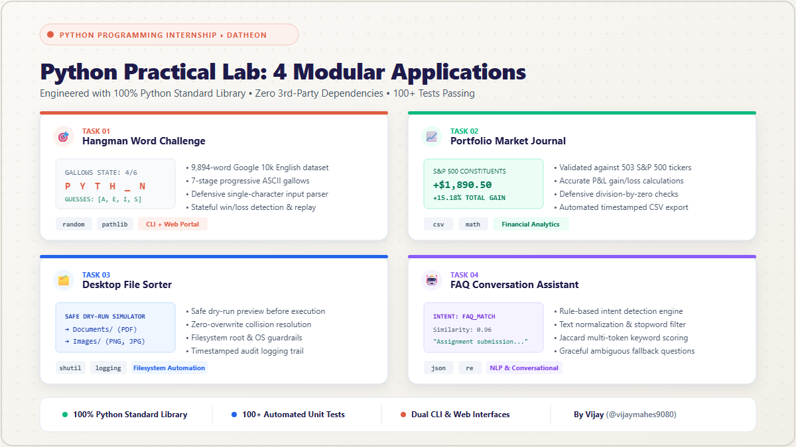

# 🚀 LinkedIn Project Showcase: Python Practical Lab

> **Ready-to-publish LinkedIn post templates and image assets in editorial light theme.**  
> Built for the **Datheon Python Programming Internship Assignment**.

---

## 📸 Image to Attach to Your Post

When publishing on LinkedIn, upload the high-resolution light-theme showcase graphic generated in this repository:

- 🖼️ **Primary Image File**: [`image.png`](image.png) *(Optimized 1200 × 675 px — 16:9 LinkedIn feed ratio)*
- 🎨 **Vector Source**: [`linkedin_showcase.svg`](linkedin_showcase.svg) *(Infinite resolution scalable vector)*
- 📁 **Archive Copy**: [`docs/assets/linkedin_showcase.png`](docs/assets/linkedin_showcase.png)



---

## 📝 Option 1: Story-Driven Post (Recommended for High Engagement)

*Copy and paste the text below into LinkedIn:*

```markdown
Can you build 4 production-grade engineering applications using ZERO external Python packages? 🐍⚡

During my Python programming internship with Datheon, I challenged myself to build the "Python Practical Lab" — a multi-project engineering suite built entirely on the Python Standard Library.

No pip installs. No third-party dependencies. Just clean, defensive, and modular Python code.

Here is what I engineered:

🎯 1. Hangman Word Challenge
A state-machine word-guessing engine featuring dynamic 7-stage ASCII gallows art, backed by a validated 9,894-word Google English dataset. Features strict single-character defensive parsing and complete replay loops.

📈 2. Portfolio Market Journal
A stock portfolio tracker and financial analysis engine validated against 503 official S&P 500 constituent companies. Calculates total portfolio value, unrealized P&L, percentage returns, and exports timestamped CSV reports.

🗂️ 3. Desktop File Sorter
An automated filesystem organizer built with a safety-first architecture. It defaults to an interactive --dry-run simulation before touching disk, includes zero-overwrite collision resolution (automatic increment renaming), and writes audit activity logs.

🤖 4. FAQ Conversation Assistant
A rule-based conversational agent with a multi-stage NLP pipeline (text normalization, English stopword removal, and Jaccard token similarity scoring) backed by a JSON knowledge base with graceful ambiguous fallbacks.

✨ Key Engineering Pillars:
• 100% Python Standard Library (random, pathlib, csv, math, os, shutil, logging, json, re)
• 100+ Automated Unit Tests passing across all 4 applications
• Dual Interface: Terminal CLI + Interactive Web Portal (HTML5/CSS3)
• Production-grade error handling, defensive input boundaries, and zero data loss guarantees

Engineering this suite reinforced how powerful Python's built-in standard library truly is when combined with clean architecture and rigorous testing.

🔗 GitHub Repository: https://github.com/vijaymahes9080/Python-programming-internship
🌐 Live Web Portal: Open index.html in any browser to explore the interactive showcase!

I’d love to hear your thoughts and feedback! What's your favourite underappreciated Python standard library module?

#Python #SoftwareEngineering #PythonProgramming #CleanCode #OpenSource #Internship #DeveloperPortfolio #Datheon #TechCommunity #Coding
```

---

## 📝 Option 2: Technical Deep-Dive Post (Recruiter & Engineer Focus)

*Copy and paste the text below into LinkedIn:*

```markdown
Proud to showcase my latest project suite: Python Practical Lab 🐍🛠️

Built as part of my Python programming internship with Datheon, this repository features 4 standalone applications exploring game logic, quantitative portfolio tracking, filesystem automation, and NLP chatbots — built with 100% Python Standard Library and zero third-party dependencies.

🏛️ Technical Breakdown:

1️⃣ Hangman Word Challenge (`word_challenge/game.py`)
• 9,894-word Google 10k English dataset integration
• 7-stage progressive ASCII gallows drawing engine
• Robust defensive input sanitization & duplicate guess tracking

2️⃣ Portfolio Market Journal (`market_journal/tracker.py`)
• Validated constituent lookup across 503 S&P 500 ticker symbols
• Real-time financial calculations (cost basis, current valuation, unrealized gain/loss)
• Automated CSV report generation with safe floating-point decimal handling

3️⃣ Desktop File Sorter (`desktop_sorter/sorter.py`)
• Mandatory safe --dry-run preview before file relocation
• Collision-free renaming logic preventing any silent file overwrites
• Root directory guards & persistent timestamped audit logs in `logs/`

4️⃣ FAQ Conversation Assistant (`faq_assistant/assistant.py`)
• Rule-based natural language processing with tokenization & stopword extraction
• Jaccard similarity scoring matched against `sample_faq.json`
• Contextual clarification and graceful fallback responses

🧪 Quality & Architecture:
• 100+ automated unit tests covering edge cases and boundary conditions
• Decoupled modular design with dual terminal CLI and web browser interfaces
• Editorial light theme UI/UX architecture

💻 Check out the complete source code on GitHub:
https://github.com/vijaymahes9080/Python-programming-internship

#Python #SoftwareDevelopment #UnitTesting #BackendDevelopment #CleanArchitecture #PythonDeveloper #Datheon
```

---

## 📝 Option 3: Concise & Impactful Post

*Copy and paste the text below into LinkedIn:*

```markdown
Excited to share my Python Practical Lab project suite! 🐍🚀

4 production-ready Python applications built exclusively with the Python Standard Library:
🎯 Task 1: Hangman Word Challenge (ASCII engine + 10k word dataset)
📈 Task 2: Portfolio Market Journal (S&P 500 analytics + CSV exports)
🗂️ Task 3: Desktop File Sorter (Safe dry-run + zero-overwrite resolution)
🤖 Task 4: FAQ Conversation Assistant (NLP intent classification + fallback)

Key Stats:
✅ 0 External Dependencies
✅ 100+ Passing Unit Tests
✅ Terminal CLI + Universal Web Portal
✅ Real-world Datasets (Google 10k English, S&P 500, Datheon FAQ)

Check out the full repository and interactive web portal here:
👉 https://github.com/vijaymahes9080/Python-programming-internship

Feedback is always welcome! 💬

#Python #Programming #CleanCode #Internship #Developers #SoftwareEngineering
```

---

## 💡 Quick Tips for Publishing

1. **Attach the Graphic**: Drag and drop [`image.png`](image.png) directly into the LinkedIn post creator. It is rendered at 1200 × 675 px (16:9 ratio) which looks crisp across mobile and desktop feeds.
2. **Tag Relevant Mentions**: Tag your mentor, internship organisation (@Datheon), and peers.
3. **Pin the Link**: Keep the GitHub link in the post body or as the first comment for maximum organic reach.
4. **Best Time to Post**: Tuesday, Wednesday, or Thursday morning between 8:00 AM – 10:30 AM local time.
