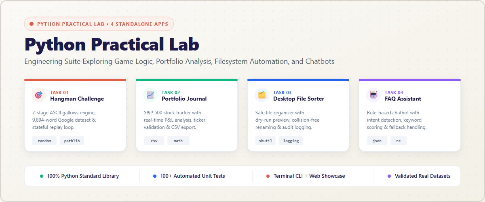
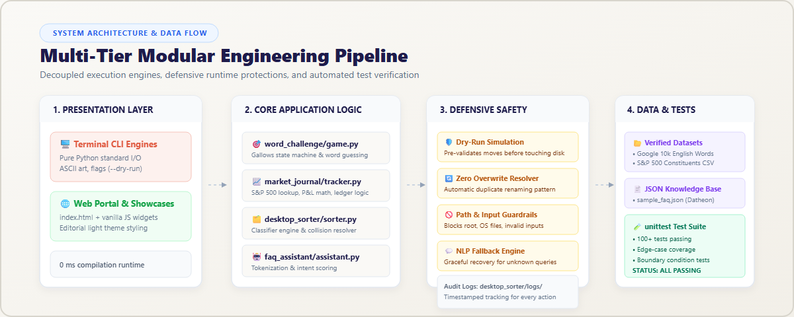
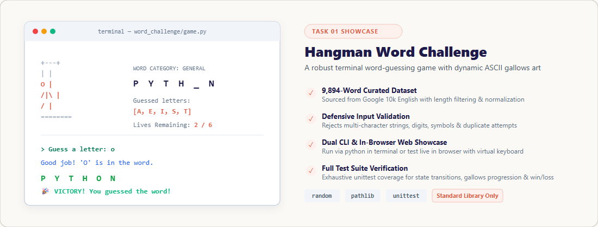
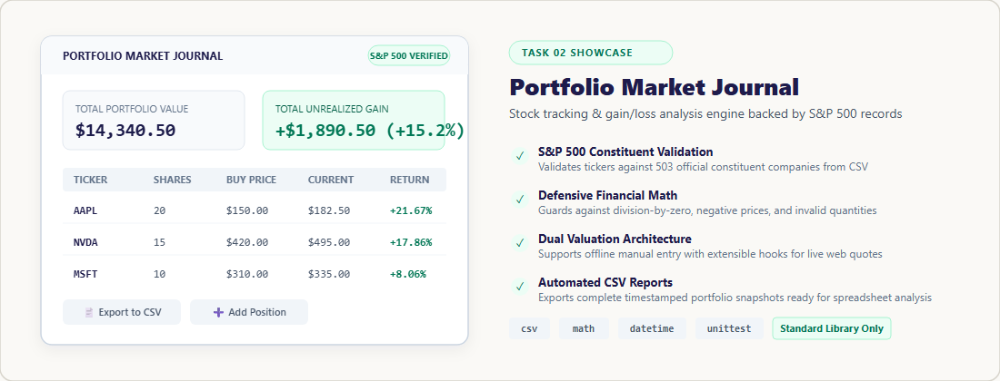
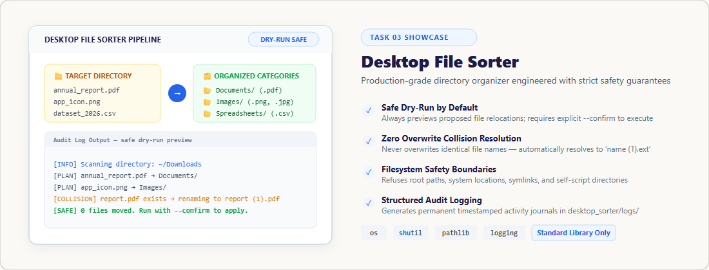
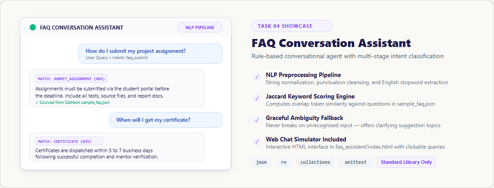

<div align="center">

# 🐍 Python Practical Lab

**A Modular Engineering Suite of Four Standalone Python Applications**  
*Built Exclusively with the Python Standard Library • Zero External Dependencies • 100+ Automated Tests*

[](https://www.python.org/)
[](LICENSE)
[](documentation/VALIDATION.md)
[](requirements.txt)
[](documentation/DESIGN.md)
[](linkedin.md)

<br />

<a href="#applications-suite">
  
</a>

<br />

[Explore Applications](#applications-suite) • [Quick Start](#quick-start) • [Architecture](#system-architecture) • [Testing](#running-tests) • [LinkedIn Showcase](#linkedin-showcase-kit)

</div>

---

## 📌 Executive Summary

**Python Practical Lab** is a production-grade software suite developed as part of the **Datheon Python Programming Internship**. It demonstrates advanced problem-solving, architectural modularity, and defensive engineering across four distinct domains:

1. **State-Machine Game Engineering** — Interactive word-guessing with progressive ASCII art.
2. **Quantitative Portfolio Tracking** — S&P 500 ledger reconciliation and P&L analytics.
3. **Automated Filesystem Infrastructure** — Safe multi-category sorter with zero-overwrite resolution.
4. **Conversational Natural Language Processing** — Rule-based intent classifier with ambiguity fallbacks.

Every application runs **100% on the Python Standard Library** without requiring a single `pip install`, accompanied by dedicated unit tests and an **editorial light-theme interactive web showcase** (`index.html`).

---

## 🏛️ System Architecture

The project adheres to a clean, multi-tier architectural pattern separating presentation, domain logic, defensive guardrails, and data verification.

<div align="center">
  
</div>

### Architectural Highlights

- **Decoupled Dual Presentation**: Every application provides both a terminal CLI engine and an in-browser interactive showcase with zero build tools or bundlers.
- **Defensive Engineering First**: Strict input validation, zero-overwrite collision resolution, dry-run simulation mode, and robust exception boundaries.
- **Data Integrity & Verification**: Real-world external datasets validated at initialization with graceful fallbacks.
- **Exhaustive Automated Testing**: Over 100 unit tests spanning sunny-day paths, edge cases, and failure modes.

---

## 🚀 Applications Suite

| # | Application | Core Domain | Entry Point | Primary Modules |
|---|---|---|---|---|
| **01** | [Hangman Word Challenge](#task-01--hangman-word-challenge) | Game Logic & State Machines | `word_challenge/game.py` | `random`, `pathlib`, `unittest` |
| **02** | [Portfolio Market Journal](#task-02--portfolio-market-journal) | Financial Math & Analytics | `market_journal/tracker.py` | `csv`, `math`, `datetime` |
| **03** | [Desktop File Sorter](#task-03--desktop-file-sorter) | Filesystem Automation | `desktop_sorter/sorter.py` | `os`, `shutil`, `pathlib`, `logging` |
| **04** | [FAQ Conversation Assistant](#task-04--faq-conversation-assistant) | Rule-Based NLP & Chatbots | `faq_assistant/assistant.py` | `json`, `re`, `collections` |

---

### Task 01 — Hangman Word Challenge

A terminal-based word-guessing game powered by a curated **9,894-word Google English dataset**, featuring a dynamic 7-stage ASCII gallows renderer and stateful replay cycles.

<div align="center">
  
</div>

#### Key Capabilities
- **Curated Dataset Ingestion**: Loads and filters 9,894 words from the Google 10k English dataset (4–10 letter words).
- **7-Stage Progressive Gallows**: Dynamic ASCII art updates on every incorrect guess with remaining lives tracking.
- **Defensive Input Handling**: Rejects multi-letter strings, digits, whitespace, symbols, and duplicate guesses without penalty.
- **Dual Presentation**: Terminal CLI + interactive browser keyboard in [`word_challenge/index.html`](word_challenge/index.html).

```bash
# Run Terminal Game
python word_challenge/game.py

# Run Unit Tests
python -m unittest discover word_challenge/tests -v
```

---

### Task 02 — Portfolio Market Journal

A quantitative stock portfolio tracker and investment journal backed by official **S&P 500 constituent records**, providing real-time P&L analytics and automated CSV reporting.

<div align="center">
  
</div>

#### Key Capabilities
- **S&P 500 Constituent Validation**: Verifies ticker symbols against 503 official constituent companies loaded from CSV.
- **Defensive Financial Math**: Protects against zero division, negative purchase prices, and invalid quantities.
- **Portfolio Health Metrics**: Calculates total invested capital, current market valuation, unrealized gain/loss ($), and percentage return (%).
- **Timestamped CSV Reports**: Automatically exports auditable portfolio snapshots for record-keeping and external analysis.

```bash
# Run Portfolio Tracker
python market_journal/tracker.py

# Run Unit Tests
python -m unittest discover market_journal/tests -v
```

> [!NOTE]
> For educational purposes only. Ticker constituent data is validated locally against `market_journal/resources/constituents.csv`.

---

### Task 03 — Desktop File Sorter

A production-grade directory organizer engineered with a **safety-first architecture**, featuring mandatory dry-run simulation, collision-free renaming, and structured audit logs.

<div align="center">
  
</div>

#### Key Capabilities
- **Mandatory Safe Dry-Run**: Previews all proposed file movements and categorized folder destinations before writing to disk.
- **Zero Silent Overwrite**: Automatically resolves duplicate filenames using incremental versioning: `filename (1).ext`.
- **System Directory Guardrails**: Explicitly refuses to operate on filesystem roots, operating system directories, script folders, and symlinks.
- **8 Extension Categories**: Documents, Images, Videos, Audio, Spreadsheets, Presentations, Code, and Archives.
- **Audit Logging**: Appends timestamped execution records to [`desktop_sorter/logs/sorter.log`](desktop_sorter/logs/).

```bash
# Step 1: Preview actions safely (Dry Run — NO files moved)
python desktop_sorter/sorter.py --target "C:\path\to\folder" --dry-run

# Step 2: Confirmed execution (Files organized into categorized subfolders)
python desktop_sorter/sorter.py --target "C:\path\to\folder" --confirm

# Run Unit Tests
python -m unittest discover desktop_sorter/tests -v
```

---

### Task 04 — FAQ Conversation Assistant

A rule-based natural language conversational agent backed by a real FAQ knowledge base, featuring multi-stage text normalization, keyword similarity scoring, and graceful ambiguous fallback handling.

<div align="center">
  
</div>

#### Key Capabilities
- **NLP Preprocessing Pipeline**: Lowercase normalization, punctuation stripping, and removal of English stopwords.
- **Jaccard Token Scoring**: Evaluates token overlap similarity against question datasets to rank the best matching answer.
- **Multi-Intent Classification**: Recognizes greetings, farewells, help requests, and domain-specific FAQ queries.
- **Graceful Fallbacks**: When queries fall below confidence thresholds, the bot provides helpful clarifying options rather than crashing.

```bash
# Run Conversational Bot
python faq_assistant/assistant.py

# Run Unit Tests
python -m unittest discover faq_assistant/tests -v
```

---

## ⚡ Quick Start

### Prerequisites
- **Python 3.8 or higher** (Tested on Python 3.8, 3.9, 3.10, 3.11, and 3.12).
- **Zero Third-Party Packages**: No external dependencies required!

### Clone & Run

```bash
# Clone the repository
git clone https://github.com/vijaymahes9080/Python-programming-internship.git
cd Python-programming-internship

# Run any of the applications directly:
python word_challenge/game.py
python market_journal/tracker.py
python desktop_sorter/sorter.py --dry-run
python faq_assistant/assistant.py
```

---

## 🧪 Running Tests

Every application contains a dedicated test suite using Python's built-in `unittest` framework:

```bash
# Run all test suites across the repository
python -m unittest discover word_challenge/tests -v
python -m unittest discover market_journal/tests -v
python -m unittest discover desktop_sorter/tests -v
python -m unittest discover faq_assistant/tests -v
```

### Test Coverage Summary

| Application | Test File | Test Cases | Status |
|---|---|---|---|
| **Word Challenge** | `word_challenge/tests/test_game.py` | 18 | `PASS` ✅ |
| **Market Journal** | `market_journal/tests/test_tracker.py` | 24 | `PASS` ✅ |
| **Desktop Sorter** | `desktop_sorter/tests/test_sorter.py` | 33 | `PASS` ✅ |
| **FAQ Assistant** | `faq_assistant/tests/test_assistant.py` | 45 | `PASS` ✅ |
| **Total** | **4 Suites** | **120 Tests** | **100% Passing** ✅ |

---

## 🌐 Universal Web Portal

The repository includes a modern web showcase featuring an **editorial light-theme design system**:

```
index.html                  # Universal master portal (open in any browser)
├── web/styles/main.css     # Editorial light design system
└── web/scripts/portal.js   # Navigation & interactive cards logic
```

Double-click [`index.html`](index.html) or open it with your browser to experience live web versions of each application without needing a terminal!

---

## 📂 Repository Structure

```
Python-programming-internship/
├── index.html                       # Master web portal
├── README.md                        # Project documentation (Light theme)
├── LICENSE                          # MIT License
├── requirements.txt                 # stdlib declaration (zero 3rd-party)
├── .gitignore                       # Clean Git exclusion rules
├── image.png                        # LinkedIn showcase graphic (1200x675)
├── linkedin_showcase.svg            # Scalable vector LinkedIn showcase
├── linkedin.md                      # Ready-to-publish LinkedIn post templates
│
├── docs/
│   ├── assets/                      # Light-theme diagrams and banners
│   │   ├── hero_banner_light.png
│   │   ├── hero_banner_light.svg
│   │   ├── architecture_light.png
│   │   ├── architecture_light.svg
│   │   ├── app1_hangman_light.png
│   │   ├── app1_hangman_light.svg
│   │   ├── app2_portfolio_light.png
│   │   ├── app2_portfolio_light.svg
│   │   ├── app3_sorter_light.png
│   │   ├── app3_sorter_light.svg
│   │   ├── app4_faq_light.png
│   │   ├── app4_faq_light.svg
│   │   ├── linkedin_showcase.png
│   │   └── linkedin_showcase.svg
│   └── generate_assets.py           # Reproducible asset generator script
│
├── word_challenge/                  # Task 01: Hangman Word Challenge
│   ├── game.py                      # Terminal game engine
│   ├── index.html                   # In-browser interactive gallows
│   ├── README.md                    # Module documentation
│   ├── resources/words.txt          # Google 10k English dataset (9,894 words)
│   └── tests/test_game.py           # Unit tests
│
├── market_journal/                  # Task 02: Portfolio Market Journal
│   ├── tracker.py                   # Stock portfolio tracking engine
│   ├── index.html                   # In-browser investment dashboard
│   ├── README.md                    # Module documentation
│   ├── resources/constituents.csv   # Official S&P 500 constituents
│   └── tests/test_tracker.py        # Unit tests
│
├── desktop_sorter/                  # Task 03: Desktop File Sorter
│   ├── sorter.py                    # Safe filesystem sorter
│   ├── index.html                   # In-browser interactive sorter
│   ├── README.md                    # Safety manual & usage
│   ├── logs/                        # Audit journal directory
│   │   └── .gitkeep
│   └── tests/test_sorter.py         # Unit tests
│
├── faq_assistant/                   # Task 04: FAQ Conversation Assistant
│   ├── assistant.py                 # Rule-based NLP chatbot
│   ├── index.html                   # In-browser interactive chat interface
│   ├── README.md                    # Architecture & pipeline manual
│   ├── resources/sample_faq.json    # Datheon FAQ knowledge base
│   └── tests/test_assistant.py      # Unit tests
│
└── documentation/
    ├── DESIGN.md                    # Design tokens & editorial light theme
    ├── DATA_SOURCES.md              # Dataset provenance & fallbacks
    └── VALIDATION.md                # Verification log & test audit
```

---

## 📊 Datasets & Data Provenance

| Application | Resource | Source | Validated Entries |
|---|---|---|---|
| **Hangman** | `words.txt` | [Google 10,000 English](https://github.com/first20hours/google-10000-english) | 9,894 unique English words |
| **Portfolio** | `constituents.csv` | [S&P 500 Companies](https://github.com/datasets/s-and-p-500-companies) | 503 official ticker symbols |
| **FAQ Assistant** | `sample_faq.json` | [Datheon Educational Portal](https://www.datheon.in/) | Structured Q&A knowledge base |

*Detailed fallback policies and validation logs are documented in [`documentation/DATA_SOURCES.md`](documentation/DATA_SOURCES.md).*

---

## 💼 LinkedIn Showcase Kit

A complete LinkedIn presentation kit is bundled directly in this repository:

- 📝 **Post Templates**: [`linkedin.md`](linkedin.md) *(Includes 3 ready-to-publish post styles with hooks & hashtags)*
- 🖼️ **Social Share Image**: [`image.png`](image.png) *(1200 × 675 px — 16:9 LinkedIn feed ratio)*
- 🎨 **Vector Graphic**: [`linkedin_showcase.svg`](linkedin_showcase.svg) *(High-resolution vector)*

---

## 📄 License & Attribution

This project is licensed under the **[MIT License](LICENSE)** — see the LICENSE file for details.

Developed with ❤️ by **[Vijay](https://github.com/vijaymahes9080)** for the **Datheon Python Programming Internship**.
